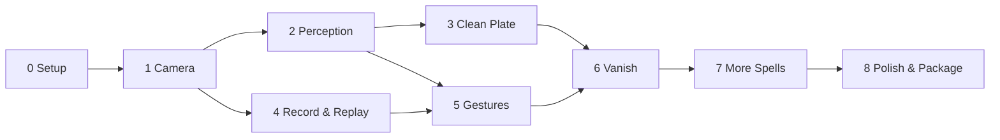

# Incanto — Build Task Plan

Task-by-task checklist for building Incanto. It follows the phases in `docs/incanto-project-plan.md`; section numbers like §4 refer to that document.

**How to use this file**
- Work top to bottom. A task's **Depends on** column lists what must be done first.
- Tick `[x]` when a task is done.
- A phase is only complete when its **Phase gate** passes on a real run, with the evidence saved (screenshot, recording, or log) in `docs/evidence/phase-N/`.
- **Privacy: the GitHub repo is public.** Screenshots, recordings, clips, mic audio, camera frames and clean plates are **LOCAL-ONLY evidence**: keep them in `docs/evidence/` (or `recordings/`, `plates/`) but they are gitignored and a pre-commit hook (`scripts/install_hooks.py`) refuses to commit them. Only `.txt` logs and reports get committed. Wherever a gate below says "screenshot" or "recording", that file stays on this machine.
- Estimates are rough, for one person.

**Status legend:** `[ ]` todo · `[~]` in progress · `[x]` done · `[!]` blocked

---

## Progress Summary

| Phase | Name | Tasks | Est. | Status |
|---|---|---|---|---|
| 0 | Setup | 7 | 0.5 h | ☑ |
| 1 | Camera pipeline | 7 | 1.5 h | ☑ |
| 2 | Perception | 9 | 2.5 h | ☑ |
| 3 | Clean plate | 8 | 1 h | ☐ |
| 4 | Record & replay | 7 | 1.5 h | ☐ |
| 5 | Gesture engine | 11 | 4 h | ☐ |
| 6 | Vanish spell | 11 | 4 h | ☐ |
| 7 | More spells | 7 | 5 h | ☐ |
| 8 | Polish & packaging | 10 | 3 h | ☐ |
| **Total** | | **77** | **~23 h** | |

---

## Phase 0: Setup

| ID | Task | Depends on | Est. | Done |
|---|---|---|---|---|
| 0.1 | Install Python 3.10+ and confirm `python --version` | — | 5m | [x] |
| 0.2 | Install OBS Studio with default options (provides the virtual camera driver) | — | 10m | [x] |
| 0.3 | Create the `code/` root folder, run `git init`, create a venv at `code/.venv` | 0.1 | 5m | [x] |
| 0.4 | Create `requirements.txt` (opencv-contrib-python, mediapipe, pyvirtualcam, sounddevice, numpy, pyyaml, pytest) and install | 0.3 | 5m | [x] |
| 0.5 | Scaffold the full folder structure from §4, with empty `__init__.py` files and stub modules | 0.3 | 10m | [x] |
| 0.6 | Add `config.yaml` from §6 and `.gitignore` (`.venv/`, `recordings/`, `plates/`, `__pycache__/`, `dist/`, `build/`, and all image/video/audio/array files; see Privacy) | 0.5 | 5m | [x] |
| 0.7 | Add a minimal `README.md` (what it is, setup steps) and make the first commit | 0.6 | 5m | [x] |

**Phase gate:** [x] `python -c "import cv2, mediapipe, pyvirtualcam, sounddevice, yaml"` runs with no errors.

---

## Phase 1: Camera pipeline

| ID | Task | Depends on | Est. | Done |
|---|---|---|---|---|
| 1.1 | `config.py`: load `config.yaml` into typed dataclasses, with validation and clear error messages | 0.6 | 15m | [x] |
| 1.2 | `io/camera.py`: open the webcam at the configured resolution/FPS; report the actual resolution; fail clearly if no camera is found | 1.1 | 15m | [x] |
| 1.3 | `io/vcam.py`: wrap `pyvirtualcam` (backend from config); convert BGR → RGB; fail clearly if the driver is missing | 1.1 | 15m | [x] |
| 1.4 | `utils/fps.py`: rolling FPS counter + per-stage timer (context manager) | — | 10m | [x] |
| 1.5 | `main.py`: loop capture → vcam; preview window with FPS overlay (preview only); `Q` to quit; clean shutdown | 1.2, 1.3, 1.4 | 20m | [x] |
| 1.6 | `utils/logging.py`: console logging with levels; log FPS every 5 seconds | 1.5 | 5m | [x] |
| 1.7 | Run it and verify in Google Meet | 1.5 | 10m | [x] |

**Phase gate:** [x] "OBS Virtual Camera" selected in Meet shows the live feed with no FPS overlay in it, and the logs show FPS ≥ 24. Save a Meet screenshot (local-only) + log excerpt (committed).

---

## Phase 2: Perception

| ID | Task | Depends on | Est. | Done |
|---|---|---|---|---|
| 2.0 | `scripts/download_models.py`: fetch the official hand landmarker and selfie segmenter `.task` model files into `models/` (gitignored); skip files already present | 1.1 | 15m | [x] |
| 2.1 | Downscale helper: produce the perception frame at `perception_width`, keeping the aspect ratio | 1.5 | 10m | [x] |
| 2.2 | `perception/segmenter.py`: MediaPipe Tasks `ImageSegmenter` (selfie segmentation model from `models/`) → float mask at full output resolution | 2.1 | 30m | [x] |
| 2.3 | Mask edge smoothing: slight blur + threshold feathering | 2.2 | 15m | [x] |
| 2.4 | Temporal mask smoothing: blend with the previous frame's mask to stop flicker | 2.3 | 15m | [x] |
| 2.5 | `perception/hands.py`: MediaPipe Tasks `HandLandmarker` (model from `models/`) → landmarks for up to 2 hands, with handedness, in normalized coords | 2.1 | 30m | [x] |
| 2.6 | `render/overlay.py`: debug HUD with green mask tint + our own hand skeleton drawing (cv2 lines/circles from landmarks; no `mp.solutions.drawing_utils`), drawn on the preview copy only; toggle with `D` | 2.4, 2.5 | 20m | [x] |
| 2.7 | Add per-stage timing (hands, segmentation) to the FPS log | 1.4, 2.5 | 10m | [x] |
| 2.8 | If FPS < 24: segmentation every 2nd frame, reusing the last mask (config flag) | 2.7 | 15m | [x] |

**Phase gate:** [x] A preview recording shows the mask following you cleanly and both hands tracked, at FPS ≥ 24. The Meet feed shows no debug overlay. Screenshots/recordings are local-only; commit the `.txt` run log.

---

## Phase 3: Clean plate

| ID | Task | Depends on | Est. | Done |
|---|---|---|---|---|
| 3.1 | `plate/clean_plate.py`: capture N frames (default 30) and average them into a plate | 1.5 | 15m | [x] |
| 3.2 | Hotkey `B`: 3-second on-screen countdown in the preview, then capture | 3.1 | 10m | [x] |
| 3.3 | Check during capture: warn if the segmenter still sees a person in the frame | 2.2, 3.1 | 10m | [x] |
| 3.4 | Save/load the plate to `plates/` (gitignored, local-only: it is a photo of the room) so it survives restarts (invalidated if the resolution changes) | 3.1 | 10m | [x] |
| 3.5 | `render/compositor.py`: `composite(frame, mask, plate)` replaces masked pixels with plate pixels | 2.4, 3.1 | 10m | [x] |
| 3.6 | Debug hotkey `V`: toggle instant vanish using the compositor | 3.5 | 5m | [x] |
| 3.7 | Camera safety net: restore auto exposure on any exit (try/finally, atexit, signals, console close) when it was set manual; `--reset-camera` command | 1.2 | 20m | [x] |
| 3.8 | Vanish mask quality: segment every frame with fast-attack/slow-release smoothing; dilated segmenter mask; filled hand hulls; plate-difference mask; near-me limit on the plate difference; per-channel plate brightness matching with a spatial gain grid; solid-core alpha with the feather only outside it; colour-aware plate difference with fast-attack/slow-release and a per-cell lighting guard; colour-coded source view and a leak view (D cycles off / sources / leak); `vanish.mask_mode` seg_only / seg_hands / full | 3.6 | 2.5h | [x] |

**Phase gate:** Pressing `V` makes you disappear with no visible hole or ghosting, live in Meet. Save before/after screenshots (local-only).

---

## Phase 4: Record & replay

| ID | Task | Depends on | Est. | Done |
|---|---|---|---|---|
| 4.1 | `io/audio.py`: mic stream thread (sounddevice, ~20 ms blocks) into a thread-safe ring buffer with timestamps | 1.5 | 20m | [ ] |
| 4.2 | `io/recorder.py`: hotkey `R` starts/stops recording raw frames to `.mp4` + mic to `.wav` in `recordings/` (gitignored, local-only), with a shared start timestamp | 4.1 | 25m | [ ] |
| 4.3 | Recorder runs on its own thread so recording never drops main-loop FPS | 4.2 | 10m | [ ] |
| 4.4 | Replay source: `python -m incanto --replay <clip>` feeds video + audio through the pipeline in sync instead of webcam/mic | 4.2 | 25m | [ ] |
| 4.5 | `--render-out <file>` option: save the composited output of a replay to `.mp4` for review | 4.4 | 10m | [ ] |
| 4.6 | Record the labeled fixture set: 10 snaps, 10 claps, 10 thumbs-ups, 2 min of talking with hand movement. Clips of the user stay **local-only** (`recordings/` or `tests/fixtures/`, both gitignored); they are never committed | 4.2 | 15m | [ ] |
| 4.7 | Label file `tests/fixtures/labels.yaml`: clip → list of (gesture, timestamp). This is the **only** file under `tests/fixtures/` that is committed | 4.6 | 15m | [ ] |

**Phase gate:** Replaying a recorded clip produces the same perception output (mask + hands) as live, and the audio stays in sync. Clips are local-only; commit only the comparison log/report.

---

## Phase 5: Gesture engine

| ID | Task | Depends on | Est. | Done |
|---|---|---|---|---|
| 5.1 | `gestures/base.py`: `GestureEvent` dataclass + `Gesture` ABC (§5) | 2.5 | 10m | [ ] |
| 5.2 | `perception/audio_onset.py`: detect sharp spikes (peak dB over threshold + decay within `audio_decay_ms`) → onset events | 4.1 | 40m | [ ] |
| 5.3 | `gestures/snap.py`: audio onset **and** a hand raised near face/shoulder within ±150 ms | 5.1, 5.2 | 30m | [ ] |
| 5.4 | `gestures/clap.py`: wrists approach above `min_approach_speed` and end within `max_wrist_distance`; boost confidence if an audio onset matches | 5.1, 5.2 | 30m | [ ] |
| 5.5 | `gestures/thumbs_up.py`: landmark pose rule (thumb up, other fingers curled) held ≥ 0.5 s | 5.1 | 25m | [ ] |
| 5.6 | `gestures/engine.py`: run all detectors each frame, collect events | 5.3–5.5 | 15m | [ ] |
| 5.7 | `triggers/manager.py`: confidence threshold, global cooldown, per-gesture debounce, gesture → spell mapping from config | 5.6 | 25m | [ ] |
| 5.8 | HUD: show the detected gesture name + confidence + cooldown bar (preview only) | 2.6, 5.7 | 10m | [ ] |
| 5.9 | `tests/test_gestures_replay.py`: run detectors on the local clips, compare to `labels.yaml`, print precision/recall per gesture. Must `pytest.skip` with a clear message when the local clips are missing, so a fresh clone still passes | 4.7, 5.6 | 30m | [ ] |
| 5.10 | Tune thresholds in `config.yaml` until the replay targets pass | 5.9 | 30m | [ ] |
| 5.11 | Unit tests for trigger cooldown + debounce logic | 5.7 | 15m | [ ] |

**Phase gate:**
- Replay report: ≥ 9/10 detected per gesture, **0** false triggers on the talking clip. Save the report output (`.txt`, committed).
- Live: 10 real snaps, ≥ 9 trigger, with the gesture name shown on the preview HUD. Save the recording (local-only).

---

## Phase 6: Vanish spell

| ID | Task | Depends on | Est. | Done |
|---|---|---|---|---|
| 6.1 | `spells/base.py`: `Spell` ABC + `SpellState` enum + state machine transitions (§3.3) | 5.7 | 20m | [ ] |
| 6.2 | `spells/registry.py`: discover spells in `spells/` by `name`; error on unknown names in config | 6.1 | 15m | [ ] |
| 6.3 | Wire trigger manager → registry → active spell into `main.py`; the compositor renders the active spell | 6.2, 3.5 | 20m | [ ] |
| 6.4 | `render/particles.py`: numpy-vectorized particle system (position, velocity, alpha, start delay); no per-particle Python loops | — | 40m | [ ] |
| 6.5 | `vanish.py` Casting: freeze masked pixels at the trigger frame, split them into `particle_size_px` blocks, spawn particles | 6.1, 6.4 | 30m | [ ] |
| 6.6 | Stagger + drift: left-to-right release delays; drift right/up with jitter; fade over `duration_s` | 6.5 | 30m | [ ] |
| 6.7 | Active state: the live mask is replaced by the clean plate every frame (you stay invisible as you move) | 6.5, 3.5 | 15m | [ ] |
| 6.8 | Reverting: particles fly back in reverse and the live you fades back in; triggered by the next snap | 6.6 | 30m | [ ] |
| 6.9 | Hotkey `C`: cancel any spell immediately back to Idle | 6.3 | 5m | [ ] |
| 6.10 | Render the effect on a replay clip with `--render-out`, review, and tune particle size/speed/stagger | 4.5, 6.8 | 30m | [ ] |
| 6.11 | Mask fingertip gaps: dilate the mask slightly and union it with a convex hull from the hand landmarks before vanish compositing (the 144x256 segmentation model misses thin fingertips; seen in Phase 2 screenshots) | 6.5, 2.5 | 30m | [x] (done early in 3.8) |

**Note (from the Phase 3 live test):** dust particles must use a strict person-only mask (the raw segmenter, with no dilation and no plate difference), so background objects (such as the chair behind you) do not dissolve. The vanish mask is deliberately larger than you; it must not drive the particles.

**Phase gate:** A screen recording **inside a Meet call** of the full cycle: snap → dissolve → invisible while moving → snap → reassemble, with FPS ≥ 24 throughout (log excerpt). The screen recording is local-only; commit only the log excerpt.

---

## Phase 7: More spells

| ID | Task | Depends on | Est. | Done |
|---|---|---|---|---|
| 7.1 | `spells/confetti.py`: one-shot burst from the hand position using the shared particle system, with gravity + fade | 6.4 | 1h | [ ] |
| 7.2 | Map `thumbs_up: confetti` in config and test live | 7.1 | 10m | [ ] |
| 7.3 | `spells/backdrop_swap.py`: replace the background (inverse mask) with images from `assets/backdrops/`, crossfading on each trigger | 6.3 | 1h | [ ] |
| 7.4 | Map `clap: backdrop_swap` and add 3–5 sample backdrop images | 7.3 | 15m | [ ] |
| 7.5 | Allow spells to stack where it makes sense (e.g. confetti over a swapped backdrop) via layer order in the compositor | 7.1, 7.3 | 45m | [ ] |
| 7.6 | Write `spells/README.md`: how to add a new spell in one file + one config line | 7.5 | 20m | [ ] |
| 7.7 | Confirm no core files changed when adding 7.1 and 7.3 (plugin design check) | 7.5 | 10m | [ ] |

**Phase gate:** A screen recording in Meet showing each gesture firing its mapped spell (local-only; commit only a `.txt` log of the triggers).

---

## Phase 8: Polish & packaging

| ID | Task | Depends on | Est. | Done |
|---|---|---|---|---|
| 8.1 | Preview HUD: active spell, cooldown, plate status, FPS (toggleable) | 5.8 | 20m | [ ] |
| 8.2 | Hotkey help overlay (`H`): B plate, R record, V vanish test, C cancel, D debug, Q quit | 8.1 | 10m | [ ] |
| 8.3 | Graceful errors: no camera, no virtual camera driver (with a link to the OBS install), mic unavailable (falls back to visual-only gestures) | 1.2, 1.3, 4.1 | 25m | [ ] |
| 8.4 | Warn when no clean plate exists and a plate-dependent spell is triggered | 3.4, 6.3 | 10m | [ ] |
| 8.5 | Exposure drift check: compare the plate to live background edges, prompt to recapture if they drift too far | 3.4 | 25m | [ ] partially done: gain matching moved into 3.8; recapture prompt done in Phase 3 as the plate health check (brightness and gain, not edges) |
| 8.6 | Final FPS pass against the §8 budget; profile and fix the slowest stage | all | 30m | [ ] |
| 8.7 | README: setup, OBS note, hotkeys, gesture → spell table, adding spells. No demo GIF/video of the user in the repo (host it outside GitHub, or use non-personal footage) | 7.6 | 30m | [ ] |
| 8.8 | PyInstaller build → `dist/Incanto.exe` with MediaPipe model files bundled | 8.6 | 30m | [ ] |
| 8.9 | Test the `.exe` from a clean folder (no venv) | 8.8 | 15m | [ ] |
| 8.10 | Tag `v1.0.0` and write release notes | 8.9 | 10m | [ ] |

**Phase gate:** A fresh run of `Incanto.exe` → full Meet call with all three spells working. Save the recording (local-only).

---

## Critical Path

Phases 3 and 4 can be done in either order after Phase 2. The particle system (6.4) has no dependencies and can be built early in parallel.

---

## Definition of Done (v1.0)

- [ ] All phase gates passed with evidence saved in `docs/evidence/`
- [ ] Snap → Vanish, Thumbs-up → Confetti, Clap → Backdrop swap all work live in Google Meet
- [ ] ≥ 24 FPS at 720p during effects
- [ ] 0 false triggers in the 2-minute talking replay
- [ ] `Incanto.exe` runs on a clean machine with only OBS Studio installed
- [ ] README (no media of the user committed)
