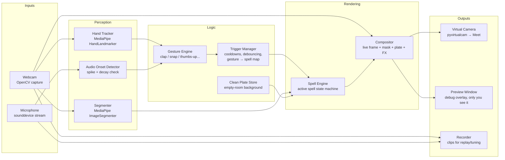
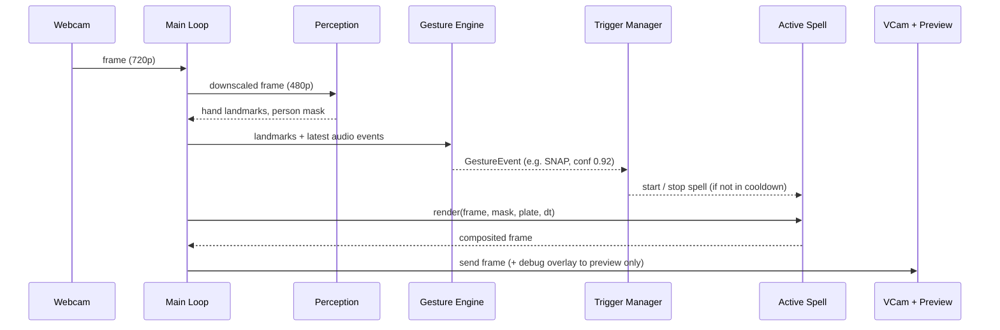
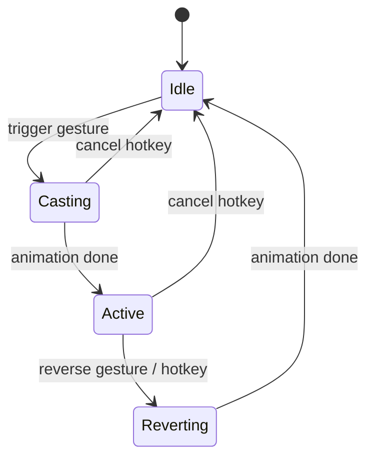

# Incanto — Project Plan & Architecture

> Cast effects on your video calls with a gesture.

Incanto is a local desktop app that watches your webcam and mic, recognizes hand gestures (snap, clap, thumbs-up, …), and plays a visual effect (a **spell**) on your video in real time. The processed video is sent to a virtual camera, so it works in Google Meet, Zoom, Teams, or any app that accepts a webcam.

Everything runs locally and uses only free, open-source tools. There are no cloud calls, API keys, or subscriptions.

---

## 1. Goals & Non-Goals

### Goals
- Real-time gesture-triggered effects at **≥ 24 FPS, 720p** on a laptop.
- First spell: **Vanish**, the snap-to-dust dissolve. You disappear, and the room behind you shows through.
- A **plugin-style spell system**, so new themes (confetti, background swap, fire, freeze, etc.) can be added without touching the core pipeline.
- **Low false triggers.** Talking with your hands should never fire a spell.
- **Record & replay**, so detection can be tuned against saved clips instead of live gestures.

### Non-Goals (for v1)
- Mobile apps.
- Cloud processing or user accounts.
- Effects that need generative AI models. Everything in v1 is classic CV and particle effects.
- A browser extension version. It's possible later; see §11.

---

## 2. Tech Stack

| Layer | Tool | Why |
|---|---|---|
| Language | Python 3.10+ | Fast to iterate; best CV ecosystem |
| Video I/O | OpenCV | Webcam capture, drawing, image ops |
| Hand tracking | MediaPipe Tasks `HandLandmarker` | 21 hand landmarks per hand, real-time on CPU (`mp.solutions` no longer exists in MediaPipe 1.x) |
| Person mask | MediaPipe Tasks `ImageSegmenter` (selfie segmentation model) | Per-pixel "this is you" mask |
| Audio | sounddevice + numpy | Mic stream for snap/clap sound spikes |
| Virtual camera | pyvirtualcam | Sends frames to a fake webcam |
| VCam driver | OBS Studio (installed, never opened) | Provides the Windows virtual camera driver |
| Config | PyYAML | Thresholds, cooldowns, gesture → spell mapping |
| Packaging (later) | PyInstaller | Single `.exe` |

**Hardware note:** MediaPipe runs fine on CPU. The dev laptop's RTX 4060 isn't required for v1, but it's available if a later spell needs GPU work.

---

## 3. Architecture

### 3.1 Component overview



### 3.2 Per-frame pipeline



### 3.3 Spell lifecycle (state machine)



For **Vanish**: *Casting* = dust dissolve, *Active* = invisible (live mask replaced with the clean plate), *Reverting* = dust reassembles.
One-shot spells like confetti go *Casting → Idle* and skip *Active*.

### 3.4 Threading model

| Thread | Job |
|---|---|
| Main | Capture → perception → spells → composite → output |
| Audio | Reads mic in ~20 ms blocks; pushes onset events into a thread-safe queue |
| Recorder (optional) | Writes frames + audio to disk without blocking the main loop |

Perception runs every frame at 480p. If FPS drops, segmentation can run every 2nd frame, reusing the last mask.

---

## 4. Project Structure

The root folder is `code/`. The Python package lives in `code/incanto/`, and all commands run from `code/`.

```
code/
├── docs/
│   ├── incanto-project-plan.md     # this file
│   └── incanto-build-tasks.md      # task-by-task build checklist
├── incanto/
│   ├── __init__.py
│   ├── main.py                     # entry point, main loop, hotkeys
│   ├── config.py                   # loads + validates config.yaml
│   ├── io/
│   │   ├── camera.py               # webcam capture
│   │   ├── vcam.py                 # pyvirtualcam output
│   │   ├── audio.py                # mic stream thread
│   │   └── recorder.py             # record + replay clips
│   ├── perception/
│   │   ├── hands.py                # HandLandmarker (Tasks API) hand landmarks
│   │   ├── segmenter.py            # ImageSegmenter person mask + edge smoothing
│   │   └── audio_onset.py          # snap/clap sound spike detection
│   ├── gestures/
│   │   ├── base.py                 # Gesture interface + GestureEvent
│   │   ├── clap.py
│   │   ├── snap.py                 # audio spike + raised hand
│   │   ├── thumbs_up.py
│   │   └── engine.py               # runs all detectors each frame
│   ├── triggers/
│   │   └── manager.py              # cooldowns, debouncing, gesture → spell map
│   ├── plate/
│   │   └── clean_plate.py          # capture + store empty-room background
│   ├── spells/
│   │   ├── base.py                 # Spell interface + state machine
│   │   ├── registry.py             # auto-discovers spells by name
│   │   ├── vanish.py               # Endgame-style dust dissolve
│   │   ├── confetti.py
│   │   └── backdrop_swap.py
│   ├── render/
│   │   ├── compositor.py           # blends frame, mask, plate, effect layers
│   │   ├── particles.py            # shared particle system
│   │   └── overlay.py              # debug HUD + our own landmark drawing (preview only)
│   └── utils/
│       ├── fps.py                  # FPS + per-stage timing
│       └── logging.py
├── models/                         # MediaPipe .task model files (gitignored)
├── scripts/
│   └── download_models.py          # fetches the model files into models/
├── assets/
│   ├── backdrops/                  # images for backdrop_swap
│   └── sounds/                     # optional local sound cues
├── recordings/                     # saved clips for tuning (gitignored, LOCAL-ONLY)
├── plates/                         # saved clean plates, photos of the room (gitignored, LOCAL-ONLY)
├── tests/
│   ├── test_gestures_replay.py     # runs detectors against recorded clips
│   ├── test_particles.py
│   └── fixtures/                   # only labels.yaml is committed; clips of the user are LOCAL-ONLY (gitignored)
├── config.yaml
├── requirements.txt
├── README.md
└── .gitignore
```

---

## 5. Core Interfaces

### Gesture

```python
@dataclass
class GestureEvent:
    name: str          # "snap", "clap", "thumbs_up"
    confidence: float  # 0.0 – 1.0
    timestamp: float
    hand: str | None   # "left", "right", or None for two-hand gestures

class Gesture(ABC):
    name: str
    @abstractmethod
    def update(self, hands, audio_events, t) -> GestureEvent | None: ...
```

### Spell

```python
class Spell(ABC):
    name: str
    state: SpellState  # IDLE, CASTING, ACTIVE, REVERTING

    def cast(self, ctx): ...       # start the effect
    def revert(self, ctx): ...     # undo (if supported)
    @abstractmethod
    def render(self, frame, mask, plate, dt) -> np.ndarray: ...
```

Adding a new theme = one new file in `spells/` + one line in `config.yaml`. The core loop never changes.

---

## 6. Configuration (`config.yaml`)

```yaml
video:
  width: 1280
  height: 720
  fps: 30
  perception_width: 640        # downscaled for detection

vcam:
  backend: obs                 # obs | unitycapture

mappings:                      # gesture → spell
  snap: vanish
  clap: backdrop_swap
  thumbs_up: confetti

triggers:
  global_cooldown_s: 3.0
  min_confidence: 0.8

gestures:
  snap:
    audio_peak_db: -18
    audio_decay_ms: 60
    hand_raised_required: true
  clap:
    max_wrist_distance: 0.08   # normalized
    min_approach_speed: 1.5

spells:
  vanish:
    particle_size_px: 4
    duration_s: 1.6
    drift: [1.0, -0.3]         # right and slightly up
    stagger: left_to_right
```

---

## 7. Phase Plan

Each phase ends with a **real-run checkpoint**: something you can see on camera or in Meet, with evidence (a screenshot, a short recording, or a log). Don't move on until the checkpoint passes.

> **Privacy: the GitHub repo is public.** Screenshots, recordings, clips, mic audio, camera frames and clean plates are **LOCAL-ONLY evidence**: they live in `docs/evidence/`, `recordings/` and `plates/` but are gitignored (and blocked by a pre-commit hook). Only `.txt` logs and reports are committed. Wherever a checkpoint below says "screenshot" or "recording", it stays on this machine.

### Phase 0: Setup (≈30 min)
- Install Python 3.10+, OBS Studio (default options), create a venv.
- `pip install opencv-contrib-python mediapipe pyvirtualcam sounddevice numpy pyyaml` (MediaPipe depends on `opencv-contrib-python`; do not also install `opencv-python`)
- Scaffold the folder structure and `config.yaml`.

**Checkpoint:** `python -c "import cv2, mediapipe, pyvirtualcam, sounddevice"` runs clean.

### Phase 1: Camera pipeline (1–2 hrs)
- `io/camera.py`, `io/vcam.py`, `main.py` loop: webcam → virtual camera, unchanged.
- Preview window + FPS counter.

**Checkpoint:** In Google Meet → Settings → Video, select **OBS Virtual Camera** and see yourself. Screenshot of Meet showing the feed, plus the FPS log (target ≥ 24).

### Phase 2: Perception (2–3 hrs)
- `scripts/download_models.py`: fetch the hand landmarker and selfie segmenter model files into `models/`.
- `perception/segmenter.py`: `ImageSegmenter` person mask with edge smoothing.
- `perception/hands.py`: `HandLandmarker` hand landmarks.
- `render/overlay.py`: debug HUD (green mask tint + our own hand skeleton drawing) in the preview window only.

**Checkpoint:** A short recording of the preview showing the mask following you cleanly and both hands tracked, with FPS still ≥ 24. The Meet feed must show **no** debug overlay.

### Phase 3: Clean plate (1 hr)
- Hotkey `B`: 3-second countdown → step out → average ~30 frames → save the plate to `plates/` (local-only, it is a photo of the room).
- Debug hotkey `V`: show the plate wherever the mask is (instant vanish, no effect).

**Checkpoint:** Toggling `V` makes you disappear with no visible hole or ghosting. Before/after screenshots.

### Phase 4: Record & replay (1–2 hrs)
- `io/recorder.py`: hotkey `R` saves synced video + audio clips to `recordings/`.
- Replay mode: `python -m incanto --replay recordings/clip.mp4` runs the full pipeline on a saved clip instead of the webcam.
- Record a labeled set: 10 snaps, 10 claps, 10 thumbs-ups, and 2 minutes of normal talking with hand movement. These clips of the user stay **local-only**; only `tests/fixtures/labels.yaml` is committed. Replay tests `pytest.skip` with a clear message when the clips are missing, so a fresh clone still passes.

**Checkpoint:** Replay of a recorded clip produces the same perception output as live.

### Phase 5: Gesture engine (3–4 hrs)
- `perception/audio_onset.py`: detect sharp sound spikes (high peak, fast decay).
- `gestures/snap.py`: audio spike **and** a raised hand near face/shoulder.
- `gestures/clap.py`: wrists approach fast and end nearly touching, optionally confirmed by an audio spike.
- `gestures/thumbs_up.py`: landmark pose held for ~0.5 s.
- `triggers/manager.py`: cooldowns, confidence threshold, gesture → spell mapping.
- `tests/test_gestures_replay.py`: runs detectors on the labeled clips and reports precision/recall.

**Checkpoint:**
- Replay report: ≥ 9/10 detected for each gesture, **0** triggers on the 2-minute talking clip.
- Live: 10 real snaps in front of the camera, ≥ 9 trigger, with "SNAP!" shown on the preview HUD.

### Phase 6: Vanish spell (3–5 hrs)
- `render/particles.py`: shared particle system (spawn, drift, fade).
- `spells/vanish.py`:
  1. Freeze your masked pixels at the trigger frame.
  2. Split them into ~4×4 px particles.
  3. Release them in a left-to-right stagger, drifting right and slightly up, fading over ~1.6 s.
  4. Clean plate shows through underneath.
  5. Stay **Active** (invisible) until you snap again → **Reverting** (particles fly back in).

**Checkpoint:** A recorded clip of the full vanish → invisible → return cycle, as seen **in Meet** (screen recording of the call). FPS stays ≥ 24 during the effect.

### Phase 7: More spells (2–3 hrs each)
- `spells/confetti.py`: thumbs-up → confetti burst (one-shot).
- `spells/backdrop_swap.py`: clap → cycle through images in `assets/backdrops/`.
- Each new spell: one file + one config line, no core changes.

**Checkpoint:** A screen recording in Meet showing each gesture firing its mapped spell.

### Phase 8: Polish & packaging (2–4 hrs)
- Small tray/HUD indicator (preview only) showing the active spell and cooldown.
- Hotkeys: `B` plate, `R` record, `C` cancel spell, `Q` quit.
- Graceful handling: no camera, no OBS driver, mic unavailable.
- README with setup steps (no demo GIF/video of the user in the repo; host any demo outside GitHub or use non-personal footage).
- PyInstaller build → `Incanto.exe`.

**Checkpoint:** On a fresh run of the `.exe`, a Meet call works end to end.

**Estimated total:** about 2–3 weekends including tuning.

---

## 8. Performance Budget (per frame, target ≤ 40 ms)

| Stage | Budget |
|---|---|
| Capture | 2 ms |
| Hand tracking (480p) | 10 ms |
| Segmentation (480p) | 8 ms |
| Gesture + triggers | 1 ms |
| Spell render + composite (720p) | 12 ms |
| VCam send | 3 ms |
| **Total** | **~36 ms (~27 FPS)** |

If over budget: run segmentation every 2nd frame, lower `perception_width`, or vectorize the particle update with numpy (no per-particle Python loops).

---

## 9. Testing Strategy

- **Replay tests** (main tool): labeled clips (local-only; labels in `tests/fixtures/labels.yaml`) run through gesture detectors, reporting precision/recall per gesture. This lets detection be tuned without performing gestures live.
- **Unit tests:** particle math, trigger cooldown logic, config validation.
- **Rendered output review:** spells can render onto a recorded clip and save an `.mp4` for visual review.
- **Real-run evidence:** each phase checkpoint needs a recording or screenshot from an actual run (ideally inside Meet), kept local-only, plus a committed `.txt` log. Passing tests alone don't close a phase.

---

## 10. Risks & Mitigations

| Risk | Mitigation |
|---|---|
| Camera moves → clean plate stops matching | Prop laptop steady; hotkey `B` to recapture anytime |
| Auto-exposure shifts brightness | Lock exposure if the camera allows; per-frame color match of plate to the live edges |
| False triggers while talking | Require audio + visual for snap; cooldowns; confidence threshold; replay-tested |
| Snap sound missed (noisy room, quiet snap) | Tunable `audio_peak_db`; hotkey fallback for every spell |
| Low FPS | Downscaled perception, frame-skipping segmentation, numpy-vectorized particles |
| Meet's own blur/background effects distort output | Turn Meet's effects off when using Incanto |
| Mask edges flicker | Temporal smoothing of the mask (blend with the previous frame) |

---

## 11. Future Ideas

- More spells: fire hands, freeze-frame, clone yourself, slow-motion trail, shrink/grow.
- Custom gesture training: record a gesture a few times, then save it as a new trigger.
- Chrome extension version (no OBS needed, browser-only).
- Spell packs / themes that users can drop into `spells/`.
- Optional GPU path for heavier effects.

---

## 12. Conventions

- Branch per phase: `phase-1-camera`, `phase-2-perception`, …
- Commits and PRs: plain, descriptive messages with no AI co-author trailers or attribution lines.
- No image, video, audio or camera-frame file of the user is ever committed, on any branch (the repo is public). `.gitignore` and the `scripts/hooks/pre-commit` hook enforce it; only stock files in `assets/` are exempt. `tests/fixtures/` holds only `labels.yaml`.
- Spells are described in text in the PR; do not upload demo clips of the user to GitHub (PR attachments are public too).
- Task-level progress is tracked in `docs/incanto-build-tasks.md`.
